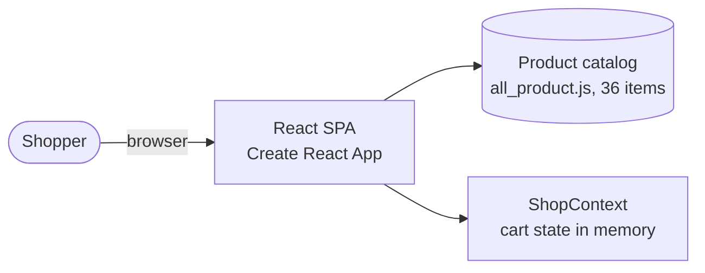

# Raj Fashion: High-Level Design

A React e-commerce front end for a fashion store: home page, men / women / kids categories, product pages, cart with totals and checkout, and login / sign-up. Live at [raj-fashion.vercel.app](https://raj-fashion.vercel.app). For code-level detail see the [Low-Level Design](lld.md).

## 1. Context

There is no backend: products are bundled data and the cart lives in React state.

## 2. Pages

| Route | Page |
|---|---|
| `/` | Shop: hero, popular, offers, new collections, newsletter |
| `/mens`, `/womens`, `/kids` | `ShopCategory` with a banner and filtered products |
| `/product/:productId` | Product display, description, related products |
| `/cart` | Cart items, totals, promo code box, checkout |
| `/login` | Login / sign-up form |

## 3. Tech

| Item | Choice |
|---|---|
| UI | React 18, React Router |
| State | Context API (`ShopContext`) |
| Build | Create React App |
| Hosting | Vercel |
