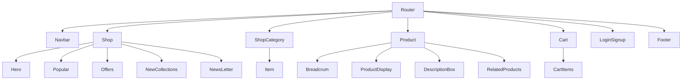
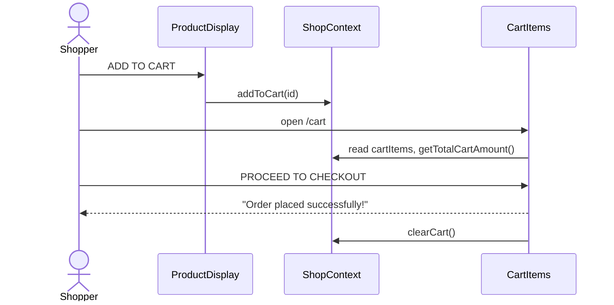

# Raj Fashion: Low-Level Design

For the big picture see the [High-Level Design](hld.md).

## 1. Product model

| Field | Example |
|---|---|
| `id` | 1 |
| `name` | Product title |
| `category` | `men`, `women` or `kid` |
| `image` | Imported image asset |
| `new_price`, `old_price` | Sale and original price |

## 2. Cart (`ShopContext`)

| Member | Behavior |
|---|---|
| `cartItems` | `{ [productId]: quantity }`, initialised to 0 for every product |
| `addToCart(id)` | +1 |
| `removeFromCart(id)` | −1 |
| `getTotalCartAmount()` | Σ `new_price × quantity` for items in the cart |
| `getTotalCartItems()` | Σ quantities (shown on the navbar cart icon) |
| `clearCart()` | Resets every quantity to 0 |

## 3. Component tree

## 4. Checkout

The cart is not persisted, so it resets on page reload; the promo box shows "Invalid promo code!" because no codes are defined.
